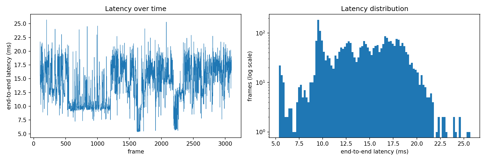

# Perception Pipeline Performance Lab

A C++20 camera-perception pipeline built to study latency, tail latency and resource contention: the problems that decide whether an autonomy stack fits its compute budget.

**Status:** Step 1 of 10 complete: a single-threaded baseline with a zero-allocation latency harness, unit tests, microbenchmarks and sanitizer CI. Next: a real YOLO model through ONNX Runtime, then multithreaded, lock-free and time-triggered designs, profiling, and a contention lab.

## Environment

- CPU: 8 vCPUs at 3264 MHz; per core 48 KiB L1d, 2 MiB L2; 12 MiB shared L3 (as reported by Google Benchmark)
- CPU model: <!-- paste the "Model name" line from: lscpu | grep "Model name" -->
- OS: Ubuntu 24.04 on WSL2 (Windows), 8 vCPUs
- Compiler: GCC 13, C++20, CMake `RelWithDebInfo` (`-O2 -g -fno-omit-frame-pointer`)
- Note: Ubuntu's Google Benchmark package reports "Library was built as DEBUG". That refers to the benchmark library itself, not the code being measured, which is built with `-O2`.

## Build and run

```bash
cmake -S . -B build -G Ninja
cmake --build build
./build/ppl_tests
./build/ppl_bench
for i in 1 2 3 4 5; do
  ./build/ppl_run --frames 3000 --csv results/baseline_run$i.csv
  python3 scripts/plot_latency.py results/baseline_run$i.csv
done
```

## Pipeline (Step 1)

A simulated camera produces 1280×720 RGB frames at a fixed 30 FPS (33.3 ms budget per frame). Each frame passes through three stages on one thread:

1. **Preprocess:** converts 2.76 M bytes to normalized floats (memory-bandwidth-bound)
2. **Inference:** a fixed 4096 → 256 matrix-vector multiply standing in for a neural network (compute-bound)
3. **Tracking:** counts scores above a threshold

All buffers are allocated once at startup, so the timed loop never allocates (checked by a unit test). Latency is measured end to end, from capture to tracker output, with `std::chrono::steady_clock`. The first 100 frames of each run are discarded as warm-up. Percentiles use the nearest-rank method.

## Results

### Step 1: single-threaded baseline (tag `v0.1-baseline`)

5 runs × 3,000 frames at 30 FPS. Each value is the **median across the 5 runs**.

| Stage | p50 (ms) | p99 (ms) | p99.9 (ms) | max (ms) | mean (ms) |
|---|---|---|---|---|---|
| **Total (end to end)** | **14.482** | **21.216** | **24.359** | **25.700** | **14.226** |
| Preprocess | 6.925 | 11.278 | 14.153 | 16.284 | 6.785 |
| Inference | 2.968 | 5.439 | 7.796 | 10.817 | 2.965 |
| Tracking | 0.001 | 0.002 | 0.025 | 0.244 | 0.001 |

Deadline misses: **0 of 15,000 frames** across all runs. The worst single frame (27.2 ms) still left 6.2 ms of the 33.3 ms budget.

Run-to-run spread of end-to-end latency:

| Run | p50 (ms) | p99 (ms) | p99.9 (ms) | max (ms) |
|---|---|---|---|---|
| 1 | 14.482 | 21.216 | 24.497 | 25.700 |
| 2 | 11.912 | 21.158 | 23.928 | 25.176 |
| 3 | 15.265 | 21.831 | 24.359 | 27.000 |
| 4 | 14.871 | 22.110 | 25.259 | 27.168 |
| 5 | 10.753 | 18.863 | 22.346 | 24.800 |



Microbenchmarks (Google Benchmark, each stage in isolation in a hot loop, single run):

| Benchmark | Time |
|---|---|
| Capture | 0.889 ms |
| Preprocess | 1.96 ms |
| Inference | 0.901 ms |
| Tracking | 0.210 µs |

### Observations

- **The tail is long relative to the median.** End-to-end p99 is 1.5× the p50, and the slowest frame is 1.8× the p50, on a single-threaded loop doing identical work every frame (the checksum is identical in all runs). That spread comes from the environment, not the code: scheduling, cache state and the hypervisor. It's the baseline every later design has to beat.
- **The median moves more between runs than the tail does.** p50 ranged from 10.8 to 15.3 ms across runs (a 42% spread), while p99 ranged from 18.9 to 22.1 ms (17%). A single run would have been misleading, which is why every result here is a median of 5.
- **Every stage runs 3–5× slower in the pipeline than in its microbenchmark.** Preprocess has a median of 6.93 ms in the pipeline against 1.96 ms isolated (3.5×); inference 2.97 ms against 0.90 ms (3.3×); capture about 4.5 ms (total minus stages) against 0.89 ms. The slowdown hits a memory-bound and a compute-bound stage alike, which points to something systematic rather than to either stage's code. The leading hypothesis: the pipeline sleeps about 20 ms between frames, so each frame starts with a lowered CPU clock and caches that other work has partly evicted, while the microbenchmark runs back-to-back with a hot cache at full clock. **Planned test:** rerun with `--fps 1000` (no sleeping). If the per-stage times converge on the microbenchmarks, the cause is idle-state recovery, which matters for any real-time loop that sleeps between frames.
- **Microbenchmarks are noisy too.** Between two `ppl_bench` runs, capture changed by 34% and inference by 15%. Any automated regression gate (Step 9) will need repeated measurements and a threshold above this noise.

## Roadmap

| Step | Topic | Status |
|---|---|---|
| 1 | Baseline pipeline, latency harness, tests, benchmarks, CI | Done |
| 2 | Real workload: YOLO11n through ONNX Runtime, letterbox preprocessing, NMS, IoU tracker | Next |
| 3 | Thread per stage with bounded mutex queues and a frame pool | |
| 4 | Lock-free SPSC ring buffer (acquire/release ordering, false-sharing study) | |
| 5 | Time-triggered single-threaded executor, CPU pinning, SCHED_FIFO, mlock | |
| 6 | Profiling: perf, flame graphs, Cachegrind, Tracy, heaptrack, data-driven optimizations | |
| 7 | Contention lab: host, CPU, memory-bandwidth and cache interference, with mitigations | |
| 8 | ONNX Runtime threading and INT8 quantization | |
| 9 | Performance-regression gate in CI | |
| 10 | Write-up | |